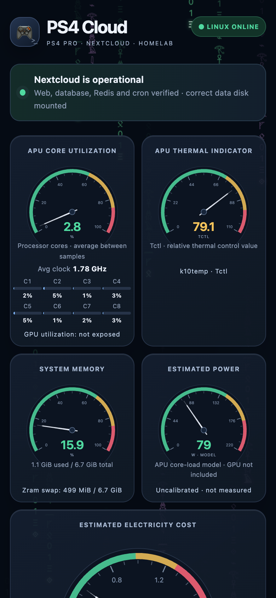

# MCsumz / Marcell

**IT Support Engineer** · hardware · systems · troubleshooting

Long-time PC builder and hands-on IT enthusiast. I like knowing what happens between the hardware, the operating system, and the application — and tracing where that chain breaks. My experience spans PC hardware, homelab infrastructure, self-hosted services, and native macOS tooling.

My approach: understand the dependencies, isolate the fault, test the fix, and leave useful notes. I care about systems that stay reliable after the troubleshooting session ends.

### On the bench

- **[PS5LM-memfix](https://github.com/MCsumz/PS5LM-memfix)** — fixes for [cobanov’s PS5LM](https://github.com/cobanov/PS5LM), the LLM server for jailbroken PS5s: long chats no longer run out of memory (0.75 GiB still free after a 47.9k-token prompt), agent tool calls keep their connection, and a Qwen3.5 follow-up takes seconds instead of minutes. Tested on a PS5 Fat and a PS5 Pro with Open WebUI, 11 models compared; most of the fixes are now in PS5LM itself. [Builds →](https://github.com/MCsumz/PS5LM-memfix/releases/latest)
- **[ONT+](https://github.com/MCsumz/ONT-Plus)** — my plus edition of [OpenNutriTracker](https://github.com/simonoppowa/OpenNutriTracker), the open-source Flutter calorie tracker: swipe Home through past and planned days, sync two phones (Android ↔ iPhone) by QR code over the local network with an encrypted three-way merge that carries edits and deletions, an all-inclusive backup, photo quick add, swipe-to-delete, drag foods between meals and full-screen editing. Fixed upstream's move on a past day debiting today's totals, and made refreshes and photo lists smoother. 3,600+ tests; signed Android APK and iOS IPA. [Release →](https://github.com/MCsumz/ONT-Plus/releases/latest)
- **[WAN watchdog](https://github.com/MCsumz/wan-watchdog)** — catches a 5G router that stays attached but stops routing: probes over DoH/DoT and TCP every 30 s, logs each outage with the radio state, and reboots the router through its own API, rate-limited. Stdlib Python, 12 tests, on my gateway since 17 Nov. [Release →](https://github.com/MCsumz/wan-watchdog/releases/latest)
- **[Claude remote sessions](https://github.com/MCsumz/claude-remote-sessions)** — keeps every Code chat of the Claude desktop app reachable from my phone as a background session with Remote Control, and updates the CLI without breaking them. Stdlib Python, 79 tests, in daily use. [Release →](https://github.com/MCsumz/claude-remote-sessions/releases/latest)
- **[Podman storage guard](https://github.com/MCsumz/podman-storage-guard)** — boot guard for rootless Podman on unjournaled storage: after an abrupt power-off it checks Podman's storage and Redis data, takes a verified backup, then repairs in stages up to a rebuild from pinned digests. Built after real corruption on my PS4 server; 32 tests. [Release →](https://github.com/MCsumz/podman-storage-guard/releases/latest)
- **[macOS tools](https://github.com/MCsumz/macos-tools)** — small Mac fixes, each with its own release: `purgeable` shows and frees the disk space macOS keeps as "purgeable" through its own CacheDelete service (3.6 GB in 9 s on my Mac mini), plus the Edge DNS profile below. One Python file, no installs; 15 tests. [Releases →](https://github.com/MCsumz/macos-tools/releases)
- **[LiS Remastered FreeCam](https://github.com/MCsumz/LiS-Remastered-FreeCam)** — UE4SS camera controls for keyboard and Xbox controller. Packaged, documented, and tested in-game. [Build →](https://github.com/MCsumz/LiS-Remastered-FreeCam/releases/latest)

### Upstream

Contributing to [cobanov/PS5LM](https://github.com/cobanov/PS5LM):

- **Merged:** [#88](https://github.com/cobanov/PS5LM/pull/88) — Qwen3.5 keeps earlier turns’ thinking, so a new message only appends instead of reprocessing the whole chat · [#112](https://github.com/cobanov/PS5LM/pull/112) — a chat no longer breaks once a tool reads the media marker · [#116](https://github.com/cobanov/PS5LM/pull/116) — Suggested downloads fetched from the commit their files are pinned at, so a re-upload on Hugging Face no longer fails the checksum.
- **In review:** [#114](https://github.com/cobanov/PS5LM/pull/114) — a model gets only a vision projector whose width fits it · [#113](https://github.com/cobanov/PS5LM/pull/113) — a keep-alive test on four endpoints.
- **Found and tested:** [11 models on a PS5 Fat and Pro](https://github.com/MCsumz/PS5LM-memfix/blob/main/docs/MODEL-TESTS.md); issues [#105](https://github.com/cobanov/PS5LM/issues/105)–[#107](https://github.com/cobanov/PS5LM/issues/107) and [#122](https://github.com/cobanov/PS5LM/issues/122); [console checks](https://github.com/MCsumz/PS5LM-memfix/blob/main/docs/UPSTREAM-TESTS.md) of unreleased `main` and others’ PRs, e.g. [#117](https://github.com/cobanov/PS5LM/pull/117)’s hybrid planner: Nemotron Nano 9B at 64k now plans a q8_0 cache in 7.6 GiB instead of q4_0 in 11.0.

### Homelab

Self-hosted on 5G: a Linux gateway publishes everything through Cloudflare Tunnel behind Cloudflare Access, and runs AdGuard Home with encrypted upstream DNS (DoH/DoT), nftables, Samba, and a [WAN watchdog](https://github.com/MCsumz/wan-watchdog) that reboots the router on outages.

- **Wake AI dashboard** — Python web app on the gateway: wakes the Mac mini M4 AI server (Ollama, Open WebUI) on demand, live telemetry, service and [Claude session](https://github.com/MCsumz/claude-remote-sessions) controls, backups. Hash-checked releases with automatic rollback.
- **PS4 Cloud dashboard** — PS4 on Linux running Nextcloud, PostgreSQL and Redis as Podman Quadlets; telemetry, maintenance mode, scheduled power actions, backups, and a [boot guard](https://github.com/MCsumz/podman-storage-guard) against storage corruption.
- **PS5 LLM servers** — PS5LM on a PS5 Fat and a PS5 Pro, used from Open WebUI and as the test bench for upstream PRs.
- **Open Terminal sandbox** — a Lima Linux VM on the Mac that gives Open WebUI a sandboxed terminal and file tools; guest code is hash-checked at boot.
- **Sysadmin ToolZz** — native SwiftUI macOS dashboard for system health, cleanup and DNS, controlling the above over SSH.

  
  
  

### Selected fixes

- **DNSSEC failures on 5G** — SERVFAILs traced to the carrier transparently intercepting all outbound UDP DNS and answering without signatures. AdGuard now sends all upstream DNS encrypted over DoH/DoT, past the interception.
- **Evening 5G stalls** — the router stays attached with a good signal but stops passing data, always in the evening, and only a full reboot helps; the [WAN watchdog](https://github.com/MCsumz/wan-watchdog) logs each stall as evidence for the carrier and reboots the router.
- **Edge "DNS not resolved" after sleep** — ~1,500 sleep/wake cycles a day left Edge's built-in resolver stale; a [configuration profile](https://github.com/MCsumz/macos-tools/tree/main/edge-dns-profile) hands DNS back to macOS.
- **Remote Claude sessions killed by CLI updates** — each auto-update re-triggered a macOS privacy prompt nobody was there to answer; the [updater](https://github.com/MCsumz/claude-remote-sessions) now gets the new version its permission first.

### Reverse engineering

AltTab's window-ordering logic rebuilt from the binary with Ghidra as a tested Swift package with a written spec.

### Toolbox

**Systems:** Linux (systemd, nftables, Podman) · macOS (launchd, configuration profiles) · DNS and home networking · Cloudflare Tunnel and Access 
**Languages:** Python · Shell · Swift · C/C++ · Lua · Go 
**Tools:** Git and GitHub · llama.cpp and Vulkan · UE4SS · Ghidra

AI-assisted development. Hands-on integration and testing. Credit to the projects these builds stand on.
