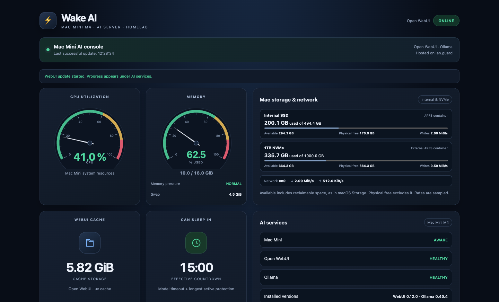
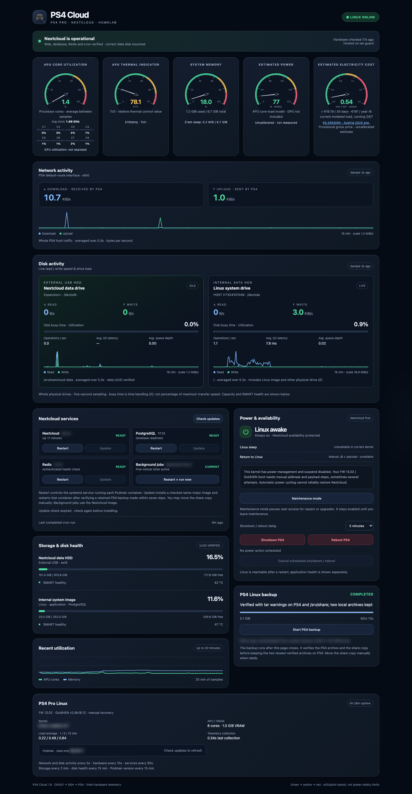

# MCsumz / Marcell

**IT Support Engineer** · hardware · systems · troubleshooting

Long-time PC builder and hands-on IT enthusiast. I like knowing what happens between the hardware, the operating system, and the application — and tracing where that chain breaks. My experience spans PC hardware, homelab infrastructure, self-hosted services, and native macOS tooling.

My approach: understand the dependencies, isolate the fault, test the fix, and leave useful notes. I care about systems that stay reliable after the troubleshooting session ends.

### On the bench

- **[PS5LM-memfix](https://github.com/MCsumz/PS5LM-memfix)** — fixes for [cobanov’s PS5LM](https://github.com/cobanov/PS5LM), the LLM server for jailbroken PS5s: long chats no longer run out of memory (0.75 GiB still free after a 47.9k-token prompt), agent tool calls keep their connection, and a Qwen3.5 follow-up takes seconds instead of minutes. Tested on a PS5 Fat with Open WebUI. [Builds →](https://github.com/MCsumz/PS5LM-memfix/releases/latest)
- **[WAN watchdog](https://github.com/MCsumz/wan-watchdog)** — catches a 5G router that stays attached but stops routing: probes every 30 s over DoH/DoT and TCP, logs each outage with the radio state, tells stalls (connections open, no data) from full outages, and reboots the router through its own API after 2 minutes, rate-limited. Python standard library only, 12 offline tests, running on my gateway since 17 Nov.
- **[Podman storage guard](https://github.com/MCsumz/podman-storage-guard)** — a boot guard for rootless Podman on filesystems without a journal: notices an abrupt power-off, checks Podman's storage and the app data (a Redis AOF check before Redis starts), takes a verified backup, then repairs in stages up to a full rebuild from pinned image digests. Built after real corruption on my PS4 Linux server; 32 offline tests, proven there on damaged throwaway storage and a real reboot.
- **[LiS Remastered FreeCam](https://github.com/MCsumz/LiS-Remastered-FreeCam)** — UE4SS camera controls for keyboard and Xbox controller. Packaged, documented, and tested in-game. [Build →](https://github.com/MCsumz/LiS-Remastered-FreeCam/releases/latest)

### Upstream

- **Merged:** [cobanov/PS5LM#88](https://github.com/cobanov/PS5LM/pull/88) — Qwen3.5 keeps earlier turns’ thinking, so a new message only appends instead of reprocessing the whole chat.
- **Offered:** [cobanov/PS5LM#98](https://github.com/cobanov/PS5LM/issues/98) — three more memfix fixes (media marker, streamed keep-alive, flash-attention scratch at load), each tested on the console.

### Homelab

Self-hosted on 5G: a Linux gateway publishes everything through Cloudflare Tunnel behind Cloudflare Access, and runs AdGuard Home with encrypted upstream DNS (DoH/DoT), nftables, Samba, and a [WAN watchdog](https://github.com/MCsumz/wan-watchdog) that reboots the router on outages.

- **Wake AI dashboard** — Python web app on the gateway: wakes the Mac mini M4 AI server (Ollama, Open WebUI) on demand, live telemetry, service and Claude session controls, backups. Hash-checked releases with automatic rollback.
- **PS4 Cloud dashboard** — PS4 on Linux running Nextcloud, PostgreSQL and Redis as Podman Quadlets; telemetry, maintenance mode, scheduled power actions, backups, and a [boot guard](https://github.com/MCsumz/podman-storage-guard) against storage corruption.
- **PS5 LLM server** — PS5LM-memfix on a PS5 Fat, used from Open WebUI.
- **Open Terminal sandbox** — a Lima Linux VM on the Mac that gives Open WebUI a sandboxed terminal and file tools; guest code is hash-checked at boot.
- **Sysadmin ToolZz** — native SwiftUI macOS dashboard for system health, cleanup and DNS, controlling the above over SSH.

  
  

### Selected fixes

- **DNSSEC failures on 5G** — SERVFAILs traced to the carrier transparently intercepting all outbound UDP DNS and answering without signatures. AdGuard now sends all upstream DNS encrypted over DoH/DoT, past the interception.
- **Evening 5G stalls** — the router stays attached with a good signal, but data stops flowing, always between about 17:30 and 22:30; a data reconnect doesn't help, only a reboot that re-registers with the network does. The WAN watchdog probes every 30 s, logs each stall with the radio state as evidence for the carrier, and reboots the router through its own API after 2 minutes, rate-limited.
- **Edge "DNS not resolved" after sleep** — ~1,500 sleep/wake cycles a day left Edge's built-in resolver stale; a [configuration profile](https://github.com/MCsumz/edge-macos-dns-profile) hands DNS back to macOS.
- **Remote Claude sessions killed by CLI updates** — each auto-update re-triggered a macOS privacy prompt nobody was there to answer; updates now run on site through a helper that gets the new version its permission first.

### Reverse engineering

AltTab's window-ordering logic rebuilt from the binary with Ghidra as a tested Swift package with a written spec.

### Toolbox

**Systems:** Linux (systemd, nftables, Podman) · macOS (launchd, configuration profiles) · DNS and home networking · Cloudflare Tunnel and Access 
**Languages:** Python · Shell · Swift · C/C++ · Lua · Go 
**Tools:** Git and GitHub · llama.cpp and Vulkan · UE4SS · Ghidra

AI-assisted development. Hands-on integration and testing. Credit to the projects these builds stand on.
